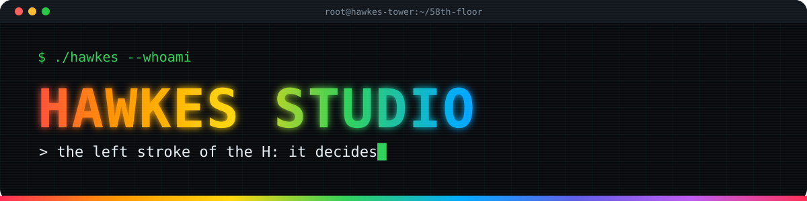

<div align="center">



<a href="https://studio.hawkesgen.ai"></a> <a href="https://github.com/jgriffith3433/hawkesstudio"></a> <a href="https://github.com/jgriffith3433/hawkesstudio"></a> <a href="https://hawkesbiomedical.com"></a>

### 🌈 **THE LEFT STROKE OF THE H: IT DECIDES** 🌈

</div>


## ⚡ `$ cat WHOAMI`

> **Studio turns what you want into code that ships. Talk writes it down as tasks with what "done" means; a loop starts AI agents on six harnesses; Gen builds and plays the result; two judges score it; live moves only on the owner's word.**

```diff
+ repo     hawkesstudio
+ live     https://studio.hawkesgen.ai
+ stack    Node 24 · TypeScript · Cloud Run · SQLite + Litestream
+ part of  the Hawkes universe: 9 products, 3 engines, one H
```


## 🧬 **THE H** · the whole machine on one screen

```
   ░░ WHO ASKS STUDIO ░░                         ░░ WHO ASKS GEN ░░
   the owner · testers · the clock               editors · game tools · the portal
              │                                               │
   ┏━━━━━━━━━━▼━━━━━━━━━━┓      jobs ━━━━━▶      ┏━━━━━━━━━━━━▼━━━━━━━━━━━━┓
   ┃   HAWKES  STUDIO    ┃                       ┃       HAWKES  GEN       ┃
   ┃   decides           ┃      ◀━━━━━ evidence  ┃       makes             ┃
   ┃   tasks · judges    ┃                       ┃   queue · router · lib  ┃
   ┗━━━━━━━━━━┳━━━━━━━━━━┛                       ┗━━━━━━━━━━━━┳━━━━━━━━━━━━┛
              ▼                                               ▼
   ░ six AI harnesses ░                          ░ rented GPUs · CPUs · browsers ░
   commits ▶ dev ▶ beta ▶ main ▶ 🌐 live          files kept forever, by their content
```

**One side decides, one side makes, and they meet in exactly one place.** Files never cross the bar, only their ids. Nothing ships until evidence about that exact commit has come back.


## 💊 **THE PRODUCT LINE** · presented as medicine, played as games

| Product | Sold as | Live | Repo |
|:--|:--|:--|:--|
| Hawkes Biomedical | *the parent company* | [hawkesbiomedical.com](https://hawkesbiomedical.com) | [`hawkesbiomedical`](https://github.com/jgriffith3433/hawkesbiomedical) |
| PH Origins | *pH balance* | [phorigins.com](https://phorigins.com) | [`phoriginswebsite`](https://github.com/jgriffith3433/phoriginswebsite) |
| Sick Of It | *single-use fever shots* | [sickofitgame.com](https://sickofitgame.com) | [`sickofitgamewebsite`](https://github.com/jgriffith3433/sickofitgamewebsite) |
| Dose Of Destruction | *cytotoxic dose* | [doseofdestruction.com](https://doseofdestruction.com) | [`doseofdestructionwebsite`](https://github.com/jgriffith3433/doseofdestructionwebsite) |
| Yooba Land | *hyporexia support* | [yoobalandgame.com](https://yoobalandgame.com) | [`YoobaLandGame`](https://github.com/jgriffith3433/YoobaLandGame) |
| I Can Be | *AI-assisted full-body assessment* | [icanbe.ai](https://icanbe.ai) | [`icanbeaiwebsite`](https://github.com/jgriffith3433/icanbeaiwebsite) |
| The Place Department | *HIPAA-compliant document storage* | [theplacedepartment.com](https://theplacedepartment.com) | [`theplacedepartmentwebsite`](https://github.com/jgriffith3433/theplacedepartmentwebsite) |
| Imagine Live TV | *live medical education* | [imaginelivetv.com](https://imaginelivetv.com) | [`imaginelivetvwebsite`](https://github.com/jgriffith3433/imaginelivetvwebsite) |
| Hawkes Games | *laboratory services* | [hawkesgames.com](https://hawkesgames.com) | [`hawkesgenwebsite`](https://github.com/jgriffith3433/hawkesgenwebsite) |

## 🛠️ **THE ENGINES** · infrastructure, not products

| Engine | Verb | What it is | Live |
|:--|:--|:--|:--|
| **➤ Hawkes Studio** | **decides** | the manager: Talk, the roadmap, AI agents, playtests, judges, the gate to live | [studio.hawkesgen.ai](https://studio.hawkesgen.ai) |
| Hawkes Gen | **makes** | the maker: one job queue, ~100 generative tools, rented GPUs, a library kept by content hash | [hawkesgen.ai](https://hawkesgen.ai) |
| Hawkes Net | **connects** | multiplayer: tickets, rooms, peer-to-peer with a relay behind it | [net.hawkesgen.ai](https://net.hawkesgen.ai) |


## 🚦 **THE LANES**

```
  dev ──▶ beta ──▶ main
  │       │        └─ 🌐 the live site. Moves only on the owner's word.
  │       └─ 🧪 a private copy, played and judged before anything ships
  └─ 💻 where work happens
```

Every repo has the same six buttons: `dev.bat` · `deploy-beta.bat` · `deploy-prod.bat` · `status.bat` · `links.bat` · `sync.bat`. Addresses and commands for this repo are in [`LANES.md`](LANES.md); the rules for agents are in [`AGENTS.md`](AGENTS.md).


## 📜 **THIS REPO** · the original README, kept

The cockpit for every Hawkes Biomedical product. Every day it builds, playtests and reviews all of them, keeps the
backlog, and writes the morning report J reads with Claude. One person, eight products, real QA.

```
auto-start.bat      →  http://127.0.0.1:8791
```

| Tab | What |
|---|---|
| **Today** | A card per product: git state, last build, each playtest scenario (local and live), Claude's verdict and scores, screenshots, open findings, and buttons to smoke-test, run a full trial, build, or go live (the plan: beta vs main and how beta played, then a typed `DEPLOY <product>`; rollback from there too) |
| **Report** | Any run: every step, the playtest videos, each review's summary and findings with screenshots |
| **Backlog** | Findings across all days, merged. Mark them fixing, fixed or won't fix |
| **Runs** | History, with every step live while a run is going |

## How it works

- **[docs/playtest.md](docs/playtest.md):** the playtest contract. Every game exposes `window.hawkesPlaytest`, and its
  own bot plays scenarios through real input.
- **[docs/daily.md](docs/daily.md):** the daily loop, and how J and Claude work it.
- **[AGENTS.md](AGENTS.md):** the commands, the layout and the rules.
- **Hawkes Gen** (`C:\Projects\hawkesgen`) does the heavy lifting as jobs:
  - Unity WebGL builds on an AWS build server that keeps each project's Library, so builds are incremental
  - Unity tests
  - browser playtests (Playwright, real GPU)
  - Claude reviews
  - generated assets

## Commands

```bash
studio.cmd status
studio.cmd daily --wait
studio.cmd playtest sickofit smoke --wait
studio.cmd build yoobaland --wait
studio.cmd test sickofit EditMode --wait
studio.cmd report latest
studio.cmd backlog
studio.cmd assets phorigins make
studio.cmd deploy doseofdestruction        # the go-live plan (beta vs main); --confirm "DEPLOY doseofdestruction" goes live
studio.cmd rollback doseofdestruction      # the rollback plan; --confirm "ROLLBACK doseofdestruction"
```

To run the daily trial at 5 AM every day: `powershell -File bin\schedule.ps1 -At 05:00` (J's call: it's a standing
setting on this PC).


<div align="center">

**🏢 Hawkes Tower · 58th floor · "We do not pitch a cure. We own the category."**

<sub>Hawkes Biomedical and every product in its line are a work of fiction. Built by one person and a great many agents.</sub>

</div>
